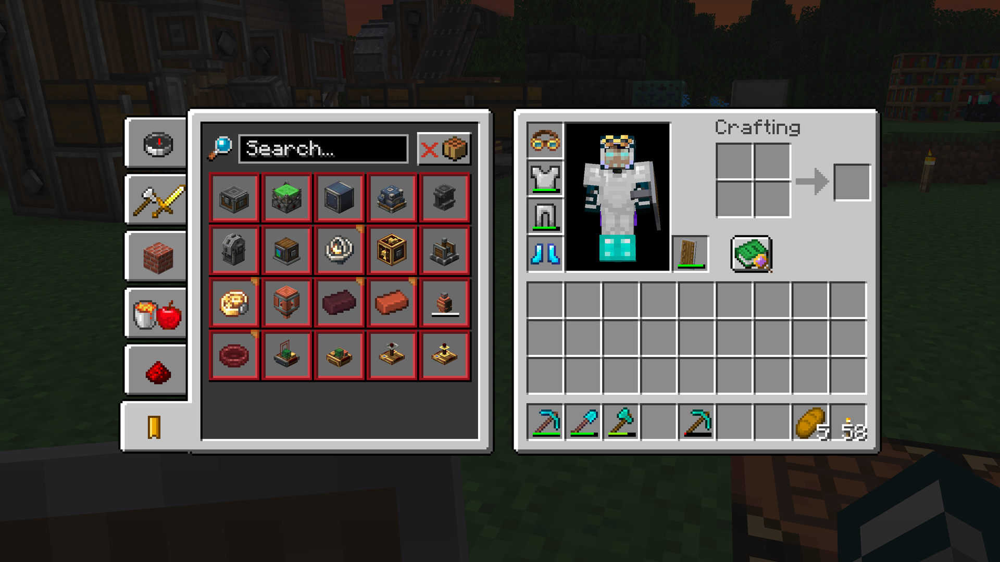
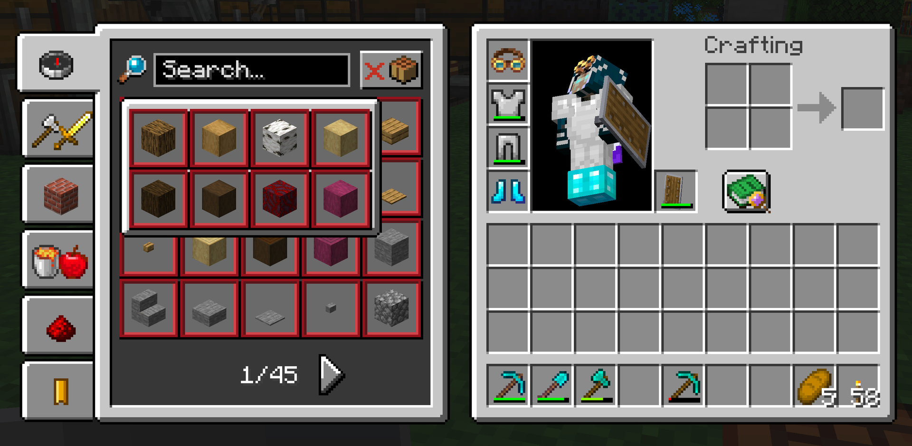
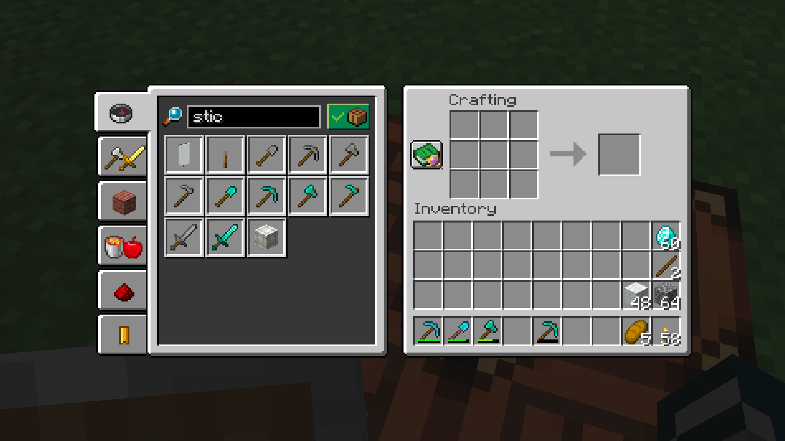
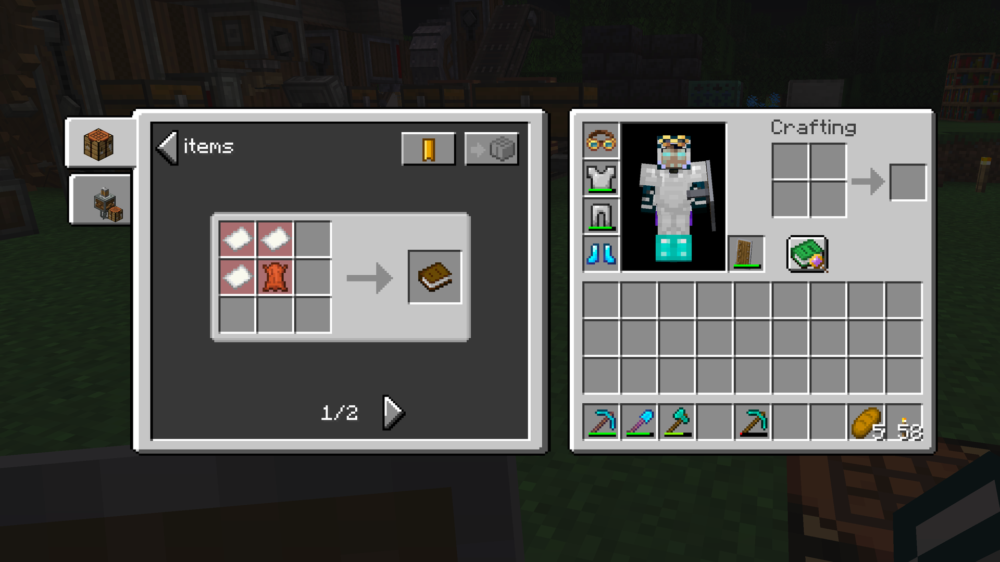
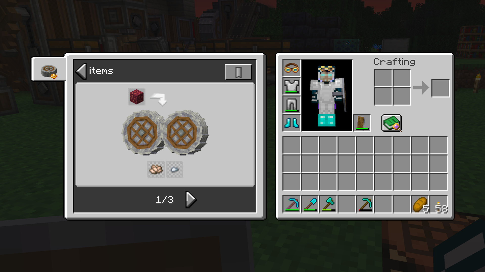

# Craftbound

Recipe book replacement to keep items hidden until you find the ingredients they need.

Craftbound replaces Minecraft's recipe book with one that adds recipes for all the mods
you have installed, through JEI, and turns them into a way to progressively discover the
game as you play.

- **Minecraft:** 1.21.1, 1.21.4, 1.21.5, 1.21.8, 1.21.10, 1.21.11 and 26.1.2
- **Mod loader:** NeoForge
- **Required:** The matching JEI version. It is what knows every mod's recipes, so the book is
  built on it.
- **Optional on 1.21.1:** Create 6.x. Create has no releases for the other supported Minecraft
  versions, so those downloads omit its recipe categories and Ponder integration.

## Screenshots

Browse every recipe by category, search them, and bookmark the ones you need.



Items that come in many variants, like logs, share one slot. Open it to pick the one you want.



Show only what you can craft from your inventory right now.



Open any item to see its recipe and place it straight into the grid.



Create's machine recipes, like crushing, show up next to vanilla ones.



## Development

Prerequisite: IntelliJ IDEA. Gradle provisions Java 21 for Minecraft 1.21.x and Java 25 for 26.x.

1. Open the project folder in IntelliJ (it imports the Gradle build automatically).
   Set the Project SDK to Java 21 if prompted.
2. The active project defaults to Minecraft 1.21.1. Switch it when working on another version:

   ```sh
   ./gradlew "Set active project to 1.21.8"
   ```

   Use `./gradlew "Reset active project"` before committing.
3. Run the **client** run configuration to launch the active version. Minecraft 1.21.1 includes
   Create by default; adding `-PnoCreate` starts it without Create, Ponder, Flywheel and Registrate.
4. Build every supported version with:

   ```sh
   ./gradlew buildAll
   ```

   Each jar is written to `versions/<version>/build/libs/`.

Useful Gradle commands:

- `./gradlew build` builds only the active Minecraft version.
- `./gradlew runClient` launches the active version's dev client.
- `./gradlew publishAllMods -PpublishDryRun` validates every release without uploading it.
- `./gradlew --refresh-dependencies` refreshes the local dependency cache.
- `./gradlew clean` clears build outputs (does not touch your source).

## License

Craftbound is licensed under the [MIT License](LICENSE).

## Resources

- Create developer docs: https://wiki.createmod.net/developers/
- NeoForge documentation: https://docs.neoforged.net/
- NeoForged Discord: https://discord.neoforged.net/
